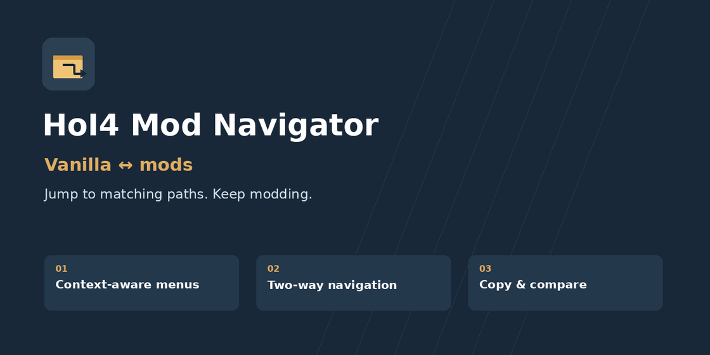
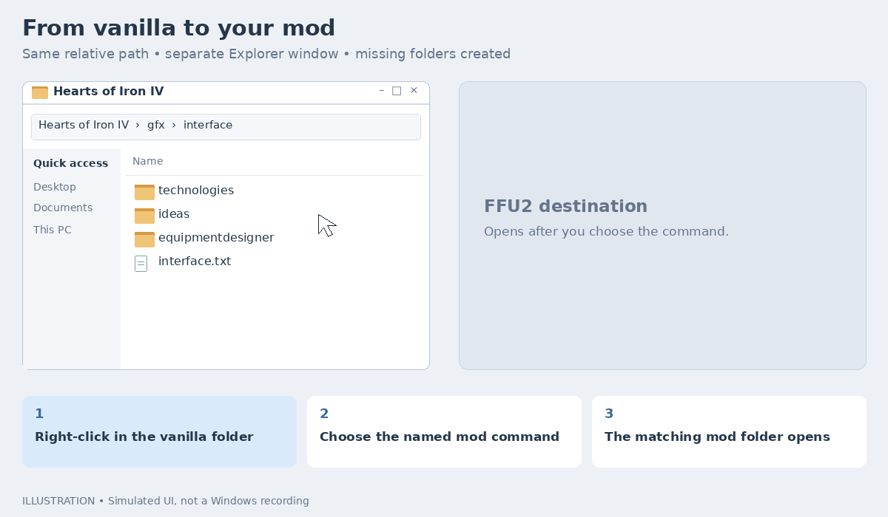
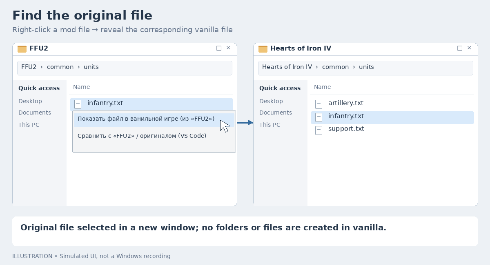
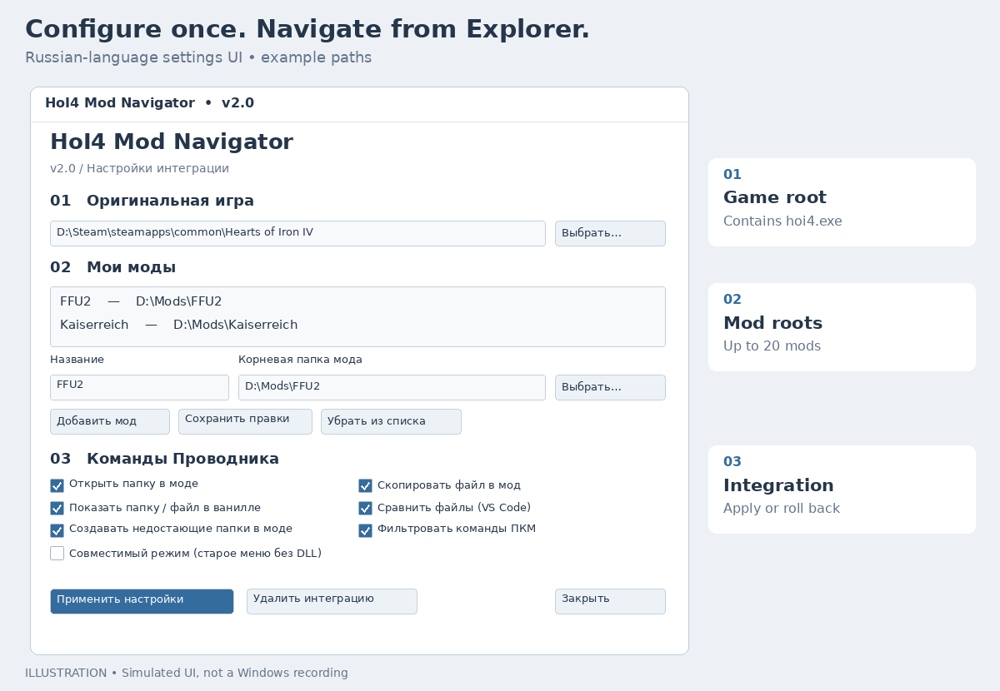

<p align="center">
  
</p>

<h1 align="center">HoI4 Mod Navigator</h1>
<p align="center"><b>Jump between Hearts of Iron IV and your mods directly from Windows Explorer.</b></p>
<p align="center">
  
  
  
  
</p>
<p align="center"><a href="README_RU.md">Русская версия</a> · <a href="docs/QUICK_START.md">Quick start</a> · <a href="CHANGELOG.md">Changelog</a> · <a href="SECURITY.md">Security</a></p>

## Stop rebuilding the same folder paths

If you mod Hearts of Iron IV, you probably spend time finding a file in the original game, switching to your mod and recreating a deep directory tree. Navigator adds commands to Windows Explorer so you can make that jump in one click.



*Illustrated workflow, not a recording of Windows. The current application interface and context-menu labels are in Russian.*

## Features

| Feature | What it does |
| --- | --- |
| Context-aware menu | Shows named destination mods inside vanilla, the reverse command inside a mod, and no dynamic commands outside configured roots and the standard local HoI4 mod directory. |
| Matching folders | Maps the relative path into your mod; creates missing directories when enabled. |
| Reverse navigation | Reveals the corresponding vanilla file and selects it in Explorer. |
| Copy to mod | Copies a vanilla file into the matching mod path; asks before replacing an existing file. |
| Compare | Opens the two versions in VS Code's diff view (VS Code required). |
| Multiple mods | Configure up to 20 mods; the dynamic menu shows one destination per mod in vanilla. |
| Separate windows | Requests a new Explorer window; actual window handling depends on Windows. |
| Compatibility | Return to the static menu or remove integration from the settings window. |

### Find the original version of a mod file



### Configure your game and mods once



*The images above use sample paths and illustrate the implemented features, not actual screenshots.*

## Automatic local mod detection

Mods in the standard Windows Documents/Paradox Interactive/Hearts of Iron IV/mod directory can navigate back to vanilla, reveal original files and compare them in VS Code without being registered. Only manually configured mods remain destinations for copying and folder creation. The actual Windows Documents known folder is used, and newly created local mod folders are recognized without reapplying settings. Steam Workshop and arbitrary external mod paths still require manual registration. Compatibility mode supports automatic reverse navigation from the folder background, not the additional automatic file commands.

## Download and install

Open the repository's **Releases** tab and download `HoI4ModNavigator-Windows-x64.zip` from the published preview. If no release has been published yet, build from source using the steps below.

**Requirements:** Windows 10 or 11 x64, a local HoI4 installation; a configured mod folder is needed for vanilla-to-mod actions. No additional runtime, account or administrator privileges are normally required. VS Code is optional. Windows 11 users may need **Show more options**.

1. Extract the archive and run `HoI4ModNavigator.exe` as a normal user after checking its origin and SHA-256.
2. Select the game root (the folder containing `hoi4.exe`).
3. For vanilla-to-mod actions, enter a mod name and root folder; click **Добавить мод** (Add mod). Repeat for other mods.
4. Click **Применить настройки** (Apply settings). Keep compatibility mode unchecked for the native menu.
5. Right-click a folder, empty folder background, or single file. Restart Explorer from Task Manager if the commands do not appear (finish active file operations first).

The installer copies itself and its embedded native DLL to `%LOCALAPPDATA%\HoI4ModNavigator\`; your settings are saved separately. There is no resident Navigator process. The native DLL is loaded by Explorer on demand.

### Preview status and SmartScreen

Version 2.1 is a preview. It contains an unsigned EXE and an in-process native COM DLL. Windows may warn about an unknown publisher. Do not disable antivirus or SmartScreen globally. Review the source and release hashes; report a real malware detection separately. Automated tests are not a substitute for a manual Explorer test.

### Known limitations

- Russian application UI; English localization is not yet implemented.
- No direct mod-to-mod navigation or adaptive submenu grouping in v2.1.
- Dynamic menu supports one selected file/folder at a time; local ordinary drive paths only. Reparse points, junctions and nested configured roots are rejected.
- Windows 11 uses the classic menu (Show more options). Some managed systems may block unsigned extensions.
- The compatibility menu may appear outside configured roots; actions still validate the source path.
- Missing originals are reported, not created. Back up mods before copying files.

## Build from source

Linux or WSL (Ubuntu example): Go 1.23+ (prefer a currently supported release), Clang, LLD and ZIP. No third-party Go packages are needed.

```sh
sudo apt update
sudo apt install clang lld zip
bash scripts/build.sh
```

Outputs in `dist/`: Windows EXE, ZIP, SHA-256 sums, Windows test executable. The native DLL and PE resources are regenerated from source. See [technical notes](docs/TECHNICAL_RU.md) and [manual Windows checklist](docs/WINDOWS_TEST_CHECKLIST.md). On Windows x64 run `dist/windows-tests.exe '-test.v'` to execute the Windows-specific tests. CI compiles and tests automatically; tagged builds create a **draft prerelease** after automated checks, not a public stable release.

## Remove / recover

In the settings window click **Удалить интеграцию** (Remove integration), or run the included `remove_integration.cmd` as your normal user. Restart Explorer if needed. To restore static commands instead, enable **Совместимый режим (старое меню без DLL)** and Apply. The cleanup does not delete mods, game files or saved settings. Do not force-delete a DLL still loaded by Explorer.

## Contributing and license

Issues and pull requests are welcome. See [CONTRIBUTING.md](CONTRIBUTING.md), [SECURITY.md](SECURITY.md) and [LICENSE](LICENSE).

Independent, unofficial modding utility. Not affiliated with Paradox Interactive, Steam, or any named mod project. No game or mod assets are distributed.
