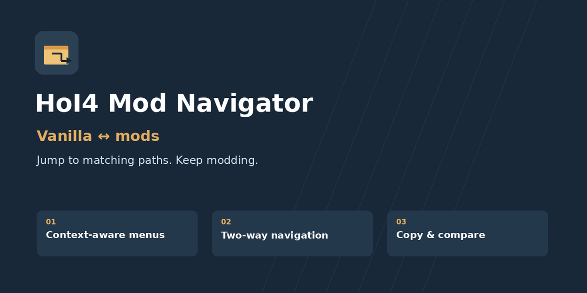
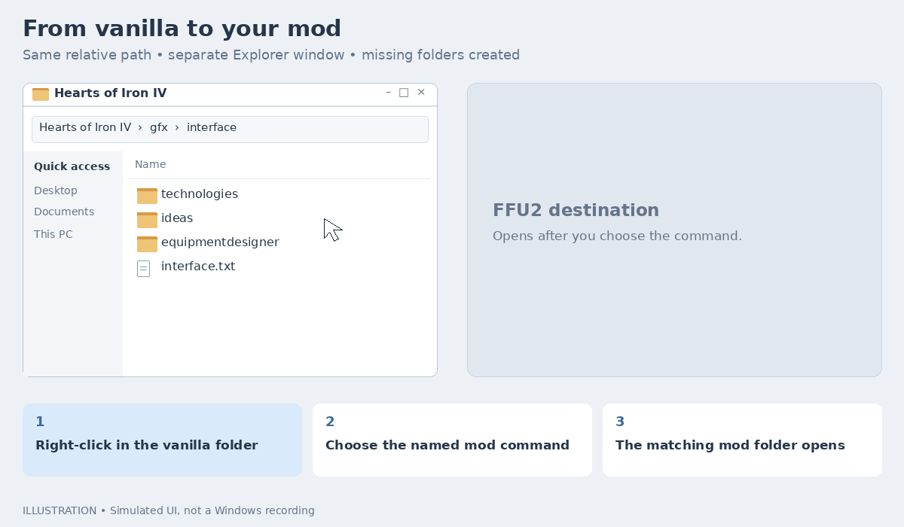
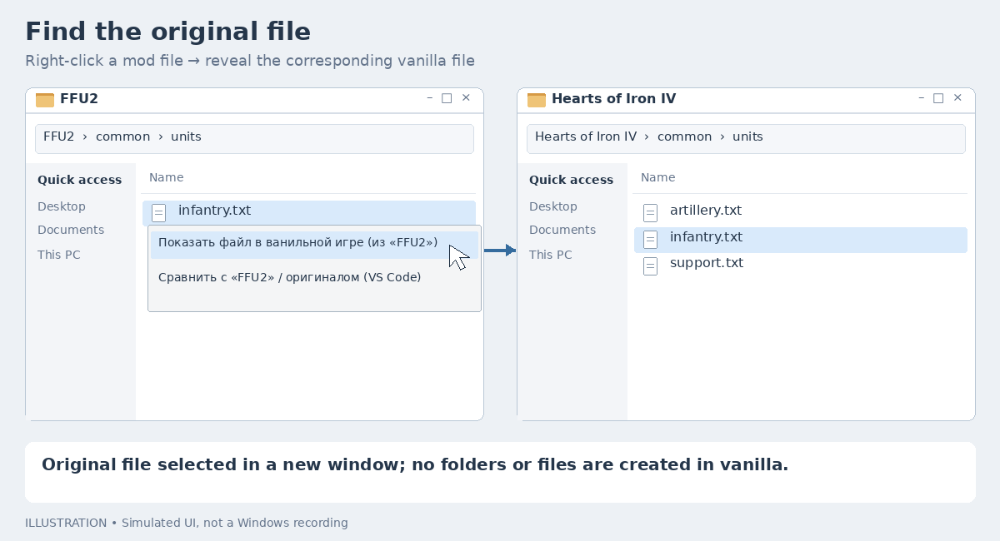
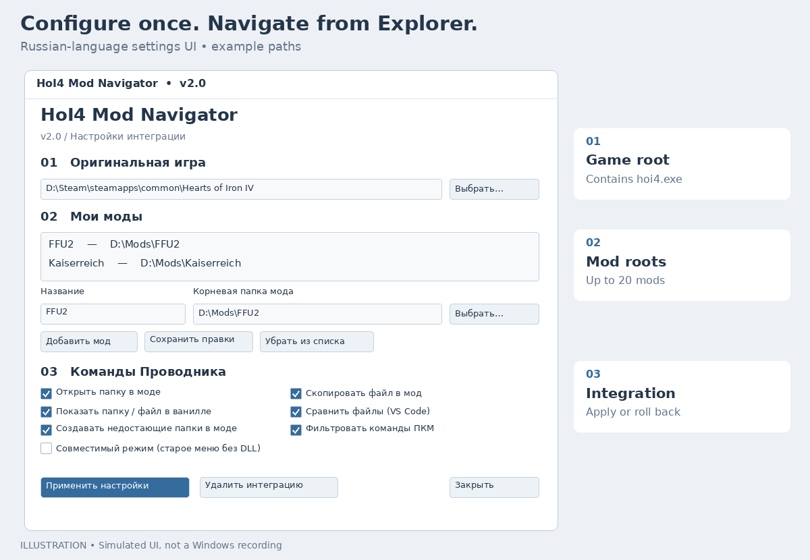

<p align="center"></p>

# HoI4 Mod Navigator

**Переходи между оригинальной Hearts of Iron IV и своими модами прямо из контекстного меню Проводника.**

[English](README.md) · [Быстрый старт](docs/QUICK_START.md) · [История изменений](CHANGELOG.md)

## Зачем нужен Navigator

Больше не нужно вручную искать папку мода и создавать всю цепочку подкаталогов. Нажми ПКМ в ванильной папке и выбери соответствующий мод. Утилита вычислит относительный путь и при необходимости создаст папки назначения.



*GIF — симуляция интерфейса, не запись рабочего стола Windows.*

## Возможности

- Динамические команды в зависимости от текущего каталога: название нужного мода в ванилле, обратная команда в моде, отсутствие динамических команд в посторонних папках.
- Автоматическое создание отсутствующих папок в моде (при включённой опции).
- Обратный переход в ваниллу с выделением соответствующего файла.
- Копирование файлов в мод с подтверждением перезаписи.
- Сравнение через VS Code, если редактор установлен.
- До 20 модов. Запрос открытия отдельного окна Проводника.
- Современный системный диалог выбора папок, сохранение настроек, совместимый режим и аварийное удаление интеграции.




*Изображения — иллюстрации реализованного функционала с примерными путями.*

## Установка

Скачай `HoI4ModNavigator-Windows-x64.zip` из опубликованного предварительного релиза во вкладке **Releases**. Если релиз ещё не опубликован, собери программу из исходников.

1. Распакуй архив и запусти EXE от обычного пользователя после проверки происхождения и SHA-256.
2. Укажи корень игры с `hoi4.exe`, название и существующую папку мода, нажми «Добавить мод».
3. Добавь остальные моды и нажми «Применить настройки». Совместимый режим для динамического меню должен быть выключен.
4. Проверь ПКМ в ванилле и моде. В Windows 11 используй «Показать дополнительные параметры». Если меню не появилось — после завершения файловых операций перезапусти Проводник через диспетчер задач.

Программа работает на Windows 10/11 x64, не требует дополнительной среды выполнения, обычно не требует прав администратора. EXE, DLL и настройки размещаются в `%LOCALAPPDATA%\HoI4ModNavigator\`.

## Ограничения предварительной версии 2.0

EXE и DLL не подписаны. SmartScreen может предупреждать о неизвестном издателе; не отключай защиту Windows глобально. DLL загружается в Explorer, поэтому возможны сбои Проводника. Используй [чек-лист проверки](docs/WINDOWS_TEST_CHECKLIST.md) и резервные копии модов.

В этой версии ещё нет переходов между самими модами, адаптивной группировки подменю и английской локализации программы. Поддерживается один выбранный объект, обычные локальные пути без junction/reparse points; вложенные корни игры/модов не поддерживаются. В совместимом режиме нейтральная команда может отображаться за пределами настроенных папок, но операция будет отклонена. Отсутствующий оригинал не создаётся.

## Сборка

Linux/WSL, Go 1.23+ (рекомендуется поддерживаемая версия), Clang, LLD и ZIP:

```sh
sudo apt update
sudo apt install clang lld zip
bash scripts/build.sh
```

Готовые файлы в `dist/`. На Windows запусти `windows-tests.exe -test.v` из `dist/`. [Техническая документация](docs/TECHNICAL_RU.md) описывает архитектуру и тесты. GitHub Actions автоматически собирает артефакты и создаёт черновик предварительного релиза по тегу после автоматических тестов.

## Удаление и откат

Нажми «Удалить интеграцию» либо запусти `remove_integration.cmd`. Для возврата к статическому меню включи совместимый режим и примени настройки. При необходимости перезапусти Проводник. Не удаляй принудительно загруженную DLL. Файлы игры, моды и настройки сохраняются.

[Лицензия MIT](LICENSE) · [Вклад в проект](CONTRIBUTING.md) · [Безопасность](SECURITY.md)

Независимая неофициальная утилита; не связана с Paradox Interactive, Steam и названными модами. Ресурсы игры и модов не распространяются.
